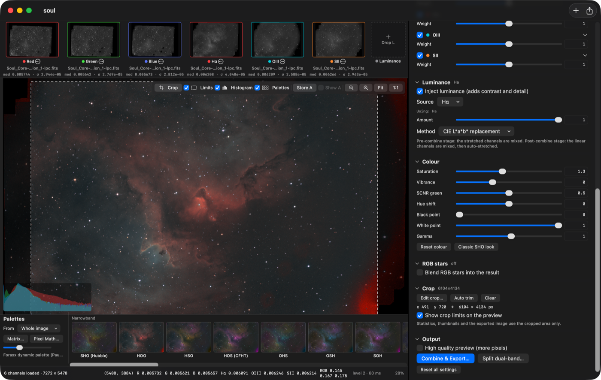

# CombineColors

A native macOS app for turning stacked monochrome astrophotography channels
(Hα, OIII, SII, Hβ, L, R, G, B) into colour images. Drop FITS or TIFF stacks
(16-bit integer or 32-bit float, linear or already stretched), pick a palette
from live thumbnails, tune the balance with a real-time preview, then export
at full resolution.



## Features

* **Input**: FITS (BITPIX 8/16/32/-32/-64, BZERO/BSCALE, NAXIS3 colour cubes,
  ROWORDER) and TIFF/PNG/JPEG (8/16-bit integer, 32-bit float) through ImageIO.
  Channel slots are filled automatically from the FITS `FILTER` keyword or the
  file name (`Hydrogen-alpha`, `O3`, `SII`, `_R`, `Lum`, …); unknown files ask.
* **Dual-band splitting** (separate pre-processing step): a one-shot-colour
  image taken through an Hα/OIII (or SII/Hβ) filter is split into two
  monochrome channels with adjustable R/G/B weights and cross-talk correction;
  the results can be saved as FITS or added straight to the channel slots.
* **Palettes**: SHO (Hubble), HOO, HSO, HOS (CFHT), OHS, OSH, SOH, HHO, a
  "natural" line-colour palette, blends (SHO Golden, SHO Soft, HOO + SII, …),
  dynamic Pixel-Math palettes (Foraxx SHO/HOO, line-ratio, OIII-protected, …),
  broadband RGB / LRGB / HαRGB, and a Monochrome palette (weighted average of
  every loaded channel). Every palette is editable:
  matrix palettes open in a weight table, dynamic ones in the Pixel Math editor.
* **Pixel Math**: expressions per output channel (R, G, B, optional L) with
  `+ - * / % ^ ~`, comparisons, `?:`, 40 functions (`mtf`, `iif`, `lerp`,
  `clamp`, `med`, `smoothstep`, …) and whole-channel statistics
  (`cmed(Ha)`, `cbg(OIII)`, `cnoise`, `cpct(x, q)`). Vectorised with Accelerate.
* **Stretch** (PixInsight-style ScreenTransferFunction and more): Auto STF
  (median → target background, shadows clipping in MADN units), manual MTF,
  arcsinh, generalised hyperbolic (GHS), logarithmic; linked or unlinked;
  applied **per channel before combining** or **to the colour image after a
  linear combination** (both orders are available because they give different
  results — see below).
* **Normalisation** of the channel strengths before combining (see the notes
  below): background equalisation, robust linear fit, background + dispersion,
  background + signal (background/emission model), noise-weighted, histogram
  matching — each computed with or without a star mask.
* **Per-channel controls**: enable, linear gain, pedestal, stretch target boost,
  post-stretch weight, black point, gamma.
* **Luminance injection** (on by default, Hα): a drop-down of recipes — Hα, L,
  `0.8 Hα + 0.1 OIII + 0.1 SII`, `0.7 Hα + 0.3 OIII` (HOO), `0.5/0.25/0.25`,
  `0.5 L + 0.5 Hα`, max or mean of the lines, or a custom Pixel Math expression.
  Missing channels are dropped and the weights renormalised (Hα → L fallback);
  injected via L*a*b* or RGB ratio with an amount slider. Works in both stretch
  stages (stretched channels mixed, or linear mix auto-stretched).
* **Colour bands** (Camera Raw style selective colour): hue, saturation and
  lightness per band — reds, oranges, yellows, greens, teals, blues, magentas.
* **Denoise**: luminance noise reduction by starlet wavelet thresholding (the
  classic astronomical method), non-local means, a guided filter or BM3D
  (block matching + collaborative 3-D filtering, the strongest classical
  denoiser), with the noise level measured from the image, protection of
  bright structures and separate chroma smoothing. No models: wavelets and
  guided filter are instant on the CPU; non-local means and BM3D run as Metal
  compute shaders on the GPU (≈ 0.1 s / 0.3 s on a 2.5 MP preview, ≈ 1 s / 4 s
  on a 40 MP export). BM3D measures the noise per DCT frequency, so the
  correlated noise of stacked, resampled data is thresholded correctly.
  Without a Metal device non-local means falls back to the CPU and BM3D to
  the wavelets.
* **Colour**: saturation, vibrance, SCNR green removal, hue rotation,
  black/white point, gamma. **Detail**: texture (fine), clarity (mid-scale)
  and dehaze (large-scale) local contrast, as in Camera Raw; the blurs are
  taken from a star-clipped luminance so stars get no dark halos, and radii
  are relative to the image so preview and export agree. Sharpening is an
  unsharp mask with amount, radius (full-resolution pixels, so judge it at
  1:1) and a Camera-Raw-like masking slider that spares the noisy sky.
  RGB star blending (screen / lighten / add with a luminance mask,
  linear or already-stretched star images detected automatically).
* **Copy preview** (⇧⌘C or the clipboard button next to the zoom controls): the
  preview as shown goes to the clipboard for a quick paste into a chat or notes.
* **Dust spot healing** (channel menu › *Heal Dust Spots…*): removes the shadows of
  dust motes and donuts from stacks that had no (or shifted) flats. A mote
  attenuates the light, so the stacked image is the true scene times a
  transmission map — the same multiplicative error a flat would divide out.
  Click a shadow and the spot is fitted (centre and extent from the radial
  profile against the surrounding sky); drag to move, drag the handle to
  resize, ⌫ deletes, *Copy to all* gives every channel the same spots (dust on
  the sensor window shadows every filter alike), the segmented control switches
  the channel so all spots are set in one go, *Original* (B) toggles the
  spots off for a before / after look. Each spot has its own model, smoothness
  and feather (the controls edit the selected spot, or the values given to new
  spots). Two models: *Local flat* (default) — the ratio of the pixels to a sky
  plane fitted around the spot (star-masked, sigma-clipped, neighbouring spots
  excluded) is decomposed into four scales from *Smooth* upwards and each
  detail layer is kept only where it exceeds its own noise, so the shadow's
  structure (fringes included) is removed while the noise grain under the spot
  passes through untouched; the shadow's own outline is found as the connected
  region below the sky noise, so elongated and irregular motes are corrected to
  their real edge, and the correction fades out over a feather band beyond it.
  *Radial profile* — one transmission per distance to the centre (median per
  annulus), robust to nebulosity, for round motes and donuts. Stars under a spot
  get the same gain (they were dimmed by the same shadow). The spots are applied
  once to the loaded channel — before statistics, normalisation and everything
  else — and cached; only Apply re-analyses the changed channels, every other
  adjustment reuses the healed data. Stored in the project and the recent-set
  state (oriented coordinates, so rotation and flips move them along).
  CLI: `--dust OIII:x,y,r;x,y,r --dust-model surface|radial --dust-smooth --dust-feather`
  (the parameters apply to the spots given on the command line).
* **Crop, rotation and flips**: one rectangle shared by every channel, drawn on the
  preview or typed in, or detected automatically from the empty registration
  borders. The crop drives statistics, channel thumbnails and the export; its
  limits can be hidden, shown as a dashed frame over the whole image, or the
  preview can show only the cropped part (tri-state *Limits* checkbox). *Rotate* (⌘R) turns every
  channel, the crop and the previews by 90° clockwise; the flip buttons
  (⇧⌘H / ⇧⌘V) mirror them. The resulting orientation is stored in the project
  and applied to channels added later.
* **Preview**: scroll or pinch to zoom around the pointer, drag (or ⌘-scroll)
  to pan, double-click toggles 1:1/fit, press-and-hold a channel thumbnail to see that
  channel alone (keep the button down and move over the other slots to switch),
  pixel read-out of every channel and of the result under the cursor, a
  histogram under the channel column, a **preset row** under the palettes (Save
  preset stores settings with a thumbnail; click to switch, right-click to
  rename/update/delete; presets are saved in the project), undo/redo of every
  adjustment. Channels that are already stretched (TIFF exports) are detected
  and the stretch is switched off.
* **Export**: TIFF 16-bit / 32-bit float, PNG 8/16-bit, JPEG, FITS 32-bit float
  / 16-bit; stretched or linear (normalised + combined only, for further
  processing elsewhere). Full resolution, rendered in strips, with the exact
  parameters of the preview.
* **Projects**: file paths, crop and every setting in one JSON file.
* **Recent sets**: every group of channel files loaded together is remembered as
  one entry (File ▸ Open Recent Set, and on the empty start screen); opening it
  reloads all channels into their slots. The settings, crop, rotation and
  presets last used with a set are saved with it automatically (no project
  file needed) and come back when it is reopened.
* **CLI** (`combinecolors-cli`) for headless batch rendering and testing.

## Building

Requirements: macOS 14+, Xcode 16+ (tested with Xcode 26 / Swift 6.3).

```bash
swift build -c release            # library, app binary, CLI
swift test                        # unit + integration tests (~40 s)
./scripts/make_app.sh             # assembles build/CombineColors.app
open build/CombineColors.app
```

`Package.swift` can also be opened in Xcode directly (the `CombineColors`
scheme runs the app).

## Using the app

1. **Load channels** — drop files or a folder on the window (or ⌘O). Drop a
   file on a specific slot (left column) to force its channel. A colour file
   opens a dialog: use it as RGB (stars/broadband) or split it as a dual-band
   image (choose the filter pair, e.g. Hα + OIII, with live previews of both
   lines; the weights and cross-talk are under *Advanced*).
2. **Crop** (optional but recommended for registered stacks with empty
   borders) — *Auto trim* finds the borders; or press the crop button, drag a
   rectangle, adjust it with the handles, press Return. The crop applies to all
   channels at once.
   *Heal Dust Spots…* in a channel's menu opens the spot editor on that channel
   (click a shadow, adjust, switch channels, Return applies).
3. **Pick a palette** from the thumbnails in the right pane (the slider at the
   top changes their size). They are re-rendered with the current settings from
   the whole image, the crop or the current view (*From* menu). Hide palettes
   you never use with the eye button (Favourites / All switch shows them again).
   *Reset all* returns every setting to the palette defaults.
4. **Tune** in the strip of blocks under the preview (Channels, Stretch,
   Normalisation, Luminance, Colour bands, Colour, Detail, RGB stars, Crop):
   click a block's vertical title to collapse or expand it, scroll sideways or
   drag on empty space to reach the others. Everything updates live; double-click a slider label to reset
   it; ⌘Z undoes. *Save preset* keeps a look in the row under the palettes to
   compare later.
5. **Export** (⌘E, File menu or toolbar) at full resolution; *HQ* in the
   preview toolbar renders the preview with more pixels.
6. **Save the project** (⌘S) to come back later.

### Pixel Math quick reference

Channels: `Ha` (`H`, `Halpha`), `OIII` (`O`, `O3`), `SII` (`S`, `S2`), `Hb`,
`R`, `G`, `B`, `L` — case-insensitive. `~x` is `1 - x` (PixInsight
convention), `^` is power. In the "stretch channels, then combine" stage the
channels are already in [0, 1]; in the "combine linear" stage they are linear
and the whole result is stretched afterwards.

Foraxx SHO as shipped:

```
R: (OIII^~OIII)*SII + ~(OIII^~OIII)*Ha
G: ((OIII*Ha)^~(OIII*Ha))*Ha + ~((OIII*Ha)^~(OIII*Ha))*OIII
B: OIII
```

### Command line

```bash
.build/release/combinecolors-cli palettes
.build/release/combinecolors-cli info  stack-Ha.fits
.build/release/combinecolors-cli render --out out --palette all --crop auto --norm backgroundSignal --linked \
    --max 2000000 Soul_Core-*-lpc.fits
.build/release/combinecolors-cli render --out out --palette foraxx_sho --max 0 --format tiff16 --project combo.json *.fits
.build/release/combinecolors-cli render --out out --palette hoo --lum haOiii --crop auto --save-project combo.json *.fits
```

`--max 0` renders at full resolution; `--project` reuses a saved project's settings.

## How the preview stays faithful to the export

Every per-channel transform (normalisation, stretch) is derived from
statistics of the *full-resolution* data (a deterministic sub-sample of up to
600 k pixels, zero padding excluded, optionally star-masked). The preview then
applies exactly those transforms to a mip-pyramid level chosen for the
viewport (≤ 3 Mpx, or ≤ 12 Mpx in high-quality mode); zooming past the level's
resolution renders crops of finer levels up to 1:1. Point-wise operations
commute with box down-sampling, so the preview *is* the down-sampled export for
linear operations and differs only by the noise averaging for the non-linear
ones. In the "combine linear, then stretch" mode the stretch parameters are
computed from full-resolution samples of the combined image, not from the
preview, so they do not drift with the zoom level. Full-resolution export runs
in 4-Mpx strips (a 40 Mpx Foraxx combination takes about half a second on an
M-series Mac).

Rendering is latest-wins on a background queue; palette thumbnails are
re-rendered in a low-priority queue 0.6 s after the last change.

## Notes on normalisation and stretching (why the options exist)

Narrowband channels differ in signal strength by large factors (Hα is usually
several times brighter than OIII and SII), so some equalisation is needed
before mapping them to colours. The approaches implemented, roughly in order
of sophistication:

* **Unlinked auto-stretch** (PixInsight STF with *unlinked* channels, Siril
  "autostretch"): each channel's median is mapped to the same target
  brightness. This is what most people see on screen and it is an implicit —
  and aggressive — normalisation. Because the STF is invariant to affine
  changes of the input, any linear normalisation or gain applied before it has
  *no visible effect*; only the per-channel target boost / weight / black point
  matter. The app shows a note when this mode is active.
* **Background equalisation**: subtract each channel's sky level (sigma-clipped
  median) and add the reference's. Removes the offset difference only.
* **Linear fit** (PixInsight `LinearFit`, Siril "Linear match"): robust
  iterative least-squares fit of the reference against each channel, applied as
  `a·x + b`. Matches both background and signal where the channels are
  correlated. It is sensitive to gradients that are not shared between the
  channels (flat-field residuals, vignetting) — regression dilution pulls the
  slope towards zero — hence the star mask and sigma rejection.
* **Background + dispersion**: match background and robust dispersion (MADN).
  The dispersion of a narrowband channel mixes noise and nebulosity, so this is
  a compromise between the next two.
* **Background + signal** (default): model each channel as *sky + emission*,
  take the sky from the sigma-clipped star-masked median and the emission level
  from a high percentile (99.5 % by default) of the star-masked image, then map
  `(x - sky) / (signal - sky)` onto the reference's range. The stars are
  excluded so that a bright star field does not define the scale; the
  percentile is adjustable.
* **Noise-weighted**: equalise the noise floor (`σ` from the MAD of neighbour
  differences). The weaker channel then *looks* weaker, which is honest and
  useful when a channel's faint signal would otherwise be amplified into
  noise; combine with a per-channel gain if needed.
* **Histogram matching**: quantile mapping of each channel onto the reference
  distribution. The strongest equalisation; it also distorts relative
  intensities within a channel, which can look artificial.

Whether to **stretch before or after combining**: stretching each channel
first (then combining) is the classic workflow for SHO/HOO because it lets
every channel reach a similar dynamic range; combining in the linear domain
and stretching once (linked) preserves the true intensity ratios and gives
colours that follow the physics (and far less green in SHO), at the cost of
the weaker lines being dimmer unless normalised. Both are one switch away;
the normalisation methods matter most with a linked stretch or the
post-combine stage.

The stretch functions follow published formulas: the midtones transfer
function and auto-STF constants (shadows clipping −2.8 MADN, target
background 0.25) are PixInsight's; arcsinh and logarithmic stretches are the
usual forms; the generalised hyperbolic stretch is the Payne/Siril formulation
(`1 − (1 + D·b·x)^(−1/b)`, mirrored about SP, linear below LP and above HP).

## Layout of the code

```
Sources/AstroCore            processing library (no UI)
  Image/                     PlanarImage, Pyramid, PixelRect/AutoCrop, Statistics, StarMask
  IO/                        FITS reader/writer, ImageIO raster reader/writer, loader, channel detection
  Processing/                Stretch, Normalization, Palettes, PostProcess, DualBand
  PixelMath/                 lexer, parser, vectorised evaluator, programs
  Pipeline/                  CombineSettings, ChannelSource, Renderer, ProjectDocument
Sources/CombineColors        SwiftUI app (model, coordinators, views)
Sources/combinecolors-cli    headless renderer
Tests/AstroCoreTests         XCTest suite (real-data tests skip when the data is absent)
Tests/CombineColorsTests     model-level app tests (loading, crop, rotation, presets, peek, recent sets)
scripts/                     make_app.sh, make_icon.py
```

See `PLAN.md` for the phase plan and the test matrix.

## Limitations / ideas

* No star removal: the RGB star blend uses a luminance mask on the RGB
  channels; a StarNet/StarXTerminator stars-only image works best (disable the
  mask).
* Gradients are not corrected; the normalisation assumes a flat sky.
* Only the primary HDU of a FITS file is read; compressed FITS (`.fz`) and
  XISF are not supported.
