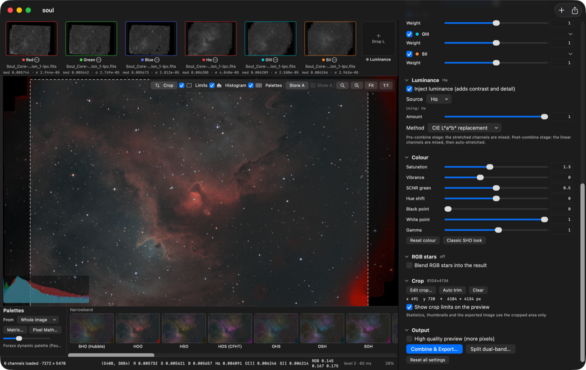

# CombineColors

A native macOS and Windows app, plus a Linux build, for turning stacked monochrome
astrophotography channels (Hα, OIII, SII, Hβ, L, R, G, B) into colour images. Drop FITS or TIFF
stacks (16-bit integer or 32-bit float, linear or already stretched), pick a
palette from live thumbnails, tune the balance with a real-time preview, then
export at full resolution.



## Features

* **Input**: FITS (BITPIX 8/16/32/-32/-64, BZERO/BSCALE, NAXIS3 colour cubes,
  ROWORDER), XISF (PixInsight's format: monolithic files, UInt8–64 and Float32/64
  samples, planar or interleaved, uncompressed / zlib / LZ4, byte-shuffled or not)
  and TIFF/PNG/JPEG (8/16-bit integer, 32-bit float) through ImageIO.
  Channel slots are filled automatically from the FITS `FILTER` keyword (also
  inside XISF files) or the file name (`Hydrogen-alpha`, `O3`, `SII`, `_R`,
  `Lum`, …); unknown files ask.
* **Background and Stars tabs** (above the channel column, ⌘1 / ⌘2): two
  sets of channels, each with its own palette, stretch, normalisation, colour,
  detail, presets, dust spots, gradient models and corrections; crop and
  rotation are shared. The **Combine stars** block of the Background tab
  blends the Stars tab, rendered with its own settings, on top (Screen /
  Lighten / Add, amount, brightness, contrast, saturation; before or after
  denoise & detail); the same checkbox on the Stars tab shows the stars being
  edited over the background. Switching tabs keeps zoom and pan. The Stars tab is filled by dropping star channels on it,
  by *Remove Stars…* (the `_stars` files) or by *Load RGB stars…* (an already
  processed stars image, without leaving the Background tab). Projects and
  recent sets keep both tabs.
* **Star removal with StarNet2** (*Remove Stars…* above the channel column, or
  Tools ▸ Remove Stars with StarNet2): runs the free [StarNet2](https://starnetastro.com/cli-tools/starnet/)
  command-line program by Mikita Misiura on the channel files, writes
  `<name>_bg` (starless) and `<name>_stars` next to each one and switches the
  channels to the `_bg` files (dust spots, gradient models, crop and painted
  corrections carry over; the originals are untouched and come back through
  File ▸ Open Recent Set); the `_stars` files go to the Stars tab and the
  combination is switched on. StarNet2 is **not bundled**: the first time, the
  window downloads the official package for this Mac from starnetastro.com
  (checked against the SHA-256 of the site's release feed) into
  `~/Library/Application Support/CombineColors/StarNet2` — no Terminal, no
  password — and shows its license for acceptance; an existing install (the
  `.pkg` in `/usr/local/bin`, or any `starnet2` / downloaded ZIP chosen by hand)
  works too. Linear data go through StarNet2's own linear mode with the
  project's Auto STF values (or, under *Options*, through the project's stretch,
  inverted afterwards), so the results stay linear; already-stretched data are
  processed as they are. On Apple Silicon the CoreML build uses the GPU: ≈ 55 s
  for a 40-megapixel frame on an M4 Pro.
* **Dual-band splitting** (separate pre-processing step): a one-shot-colour
  image taken through an Hα/OIII (or SII/Hβ) filter is split into two
  monochrome channels with adjustable R/G/B weights and cross-talk correction;
  the results can be saved as FITS or added straight to the channel slots.
* **Palettes**: SHO (Hubble), HOO, HSO, HOS (CFHT), OHS, OSH, SOH, HHO, a
  "natural" line-colour palette, blends (SHO Golden, SHO Soft, HOO + SII, …),
  dynamic Pixel-Math palettes (Foraxx SHO/HOO, line-ratio, OIII-protected, …),
  broadband RGB / LRGB / HαRGB, and a Monochrome palette (weighted average of
  every loaded channel). Every palette is editable:
  matrix palettes open in a weight table, dynamic ones in the Pixel Math editor
  (both are movable panels, so the preview stays in view while editing).
* **Pixel Math**: expressions per output channel (R, G, B, optional L) with
  `+ - * / % ^ ~`, comparisons, `?:`, 40 functions (`mtf`, `iif`, `lerp`,
  `clamp`, `med`, `smoothstep`, …) and whole-channel statistics
  (`cmed(Ha)`, `cbg(OIII)`, `cnoise`, `cpct(x, q)`). Vectorised with Accelerate.
* **Stretch** (PixInsight-style ScreenTransferFunction and more): Auto STF
  (median → target background, shadows clipping in MADN units), manual MTF,
  arcsinh, generalised hyperbolic (GHS), logarithmic; linked or unlinked.
  The manual methods are set relative to the data's noise, so their sliders
  cover the useful range on any linear stack (the absolute PixInsight-style
  values are shown under them); GHS points are percentiles of the image
  (50 % ≈ the sky). The block shows only the parameters of the chosen method;
  applied **per channel before combining** or **to the colour image after a
  linear combination** (both orders are available because they give different
  results — see below).
* **Normalisation** of the channel strengths before combining (see the notes
  below): background equalisation, robust linear fit, background + dispersion,
  background + signal (background/emission model), noise-weighted, histogram
  matching — each computed with or without a star mask.
* **Per-channel controls**: enable, linear gain, pedestal, stretch target boost,
  post-stretch weight, black point, gamma.
* **Luminance injection** (on by default, Hα): a drop-down of recipes — Hα, L,
  `0.8 Hα + 0.1 OIII + 0.1 SII`, `0.7 Hα + 0.3 OIII` (HOO), `0.5/0.25/0.25`,
  `0.5 L + 0.5 Hα`, max or mean of the lines, or a custom Pixel Math expression.
  Missing channels are dropped and the weights renormalised (Hα → L fallback);
  injected via L*a*b* or RGB ratio with an amount slider. Works in both stretch
  stages (stretched channels mixed, or linear mix auto-stretched).
* **Colour bands** (Camera Raw style selective colour): hue, saturation and
  lightness per band — reds, oranges, yellows, greens, teals, blues, magentas;
  *Softness* feathers the bands into their neighbours.
* **Denoise** (before Detail: local contrast and sharpening then work on the
  cleaner image): luminance noise reduction by starlet wavelet thresholding (the
  classic astronomical method), non-local means, a guided filter or BM3D
  (block matching + collaborative 3-D filtering, the strongest classical
  denoiser), with the noise level measured from the image, protection of
  bright structures and separate chroma smoothing. No models: wavelets and
  guided filter are instant on the CPU; non-local means and BM3D run as Metal
  compute shaders on the GPU (≈ 0.1 s / 0.3 s on a 2.5 MP preview, ≈ 1 s / 4 s
  on a 40 MP export). BM3D measures the noise per DCT frequency, so the
  correlated noise of stacked, resampled data is thresholded correctly.
  Without a Metal device non-local means falls back to the CPU and BM3D to
  the wavelets. *Hot pixels* replaces isolated single-pixel spikes (often
  brought out by strong colour edits) by their neighbours' median, at full
  resolution (1:1 preview and export).
* **Colour**: saturation, vibrance, SCNR green removal, hue rotation.
  **Contrast** (after Balance, so the colour controls stay together): exposure
  (stops), brightness (mid-tones), contrast (S-curve, or its inverse),
  highlights and shadows (bright / dark tones with black, mid-tone and white
  fixed), black / white point and gamma — one per-channel curve.
  **Balance** (Photoshop-style, applied after Colour and before Contrast,
  Denoise and Detail; a switch shows one tool at a time): *Color Balance* (±50) with cyan–red, magenta–green and yellow–blue sliders for the
  shadows, midtones and highlights (overlapping lightness masks, *Preserve luminosity*), and
  *Selective Color* for the whites, neutrals and blacks (cyan, magenta, yellow and black ink,
  *Relative* or *Absolute*; the hue ranges are the Colour bands block). **Detail**: local contrast at five scales — micro-structures (0.2 % of the
  width), texture (0.6 %), clarity (6 %), dehaze (25 %, haze subtraction) and
  low frequency (50 %), as in Camera Raw with two extra scales for large frames; the blurs are
  taken from a star-clipped luminance so stars get no dark halos, and radii
  are relative to the image so preview and export agree. Sharpening is an
  unsharp mask with amount, radius (full-resolution pixels, so judge it at
  1:1) and a Camera-Raw-like masking slider that spares the noisy sky.
  RGB star blending (screen / lighten / add with a luminance mask,
  linear or already-stretched star images detected automatically).
* **Copy preview** (⇧⌘C or the clipboard button next to the zoom controls): the
  preview as shown (the cropped part when a crop is set) goes to the clipboard
  for a quick paste into a chat or notes.
* **Dust spot healing** (channel menu › *Heal Dust Spots…*): removes the shadows of
  dust motes and donuts from stacks that had no (or shifted) flats. A mote
  attenuates the light, so the stacked image is the true scene times a
  transmission map — the same multiplicative error a flat would divide out.
  Click a shadow and the spot is fitted (centre and extent from the radial
  profile against the surrounding sky); drag to move, drag the handle to
  resize, ⌫ deletes, *Copy to all* gives every channel the same spots (dust on
  the sensor window shadows every filter alike), the segmented control switches
  the channel so all spots are set in one go, *Original* (B) toggles the
  spots off for a before / after look. Each spot has its own model, smoothness
  and feather (the controls edit the selected spot, or the values given to new
  spots). Two models: *Local flat* (default) — the ratio of the pixels to a sky
  plane fitted around the spot (star-masked, sigma-clipped, neighbouring spots
  excluded) is decomposed into four scales from *Smooth* upwards and each
  detail layer is kept only where it exceeds its own noise, so the shadow's
  structure (fringes included) is removed while the noise grain under the spot
  passes through untouched; the shadow's own outline is found as the connected
  region below the sky noise, so elongated and irregular motes are corrected to
  their real edge, and the correction fades out over a feather band beyond it.
  *Radial profile* — one transmission per distance to the centre (median per
  annulus), robust to nebulosity, for round motes and donuts. Stars under a spot
  get the same gain (they were dimmed by the same shadow). The spots are applied
  once to the loaded channel — before statistics, normalisation and everything
  else — and cached; only Apply re-analyses the changed channels, every other
  adjustment reuses the healed data. Stored in the project and the recent-set
  state (oriented coordinates, so rotation and flips move them along).
  CLI: `--dust OIII:x,y,r;x,y,r --dust-model surface|radial --dust-smooth --dust-feather`
  (the parameters apply to the spots given on the command line).
* **Guided gradient removal** (channel menu › *Remove Gradient…*): takes a smooth
  background — sky glow, light pollution, vignetting from missing flats — out of a
  channel, guided by a shape you draw over it rather than by a free parametric
  surface (which has to be flexible enough to follow the gradient and is then
  flexible enough to eat the nebula). Drag a **line** along the gradient when it
  comes from one side (the background then varies along the line and is constant
  across it); drag an **ellipse** from the centre of a radial fall-off or glow
  (the centre may be dragged outside the frame afterwards — a glow from a bright
  star off-frame); or choose **Polynomial** for the classic degree-n surface. The
  guide fixes the shape, the algorithm estimates a robust 1-D profile along it
  from star-masked cell medians (median per bin, smoothed), optionally with
  angular *sectors* (ellipse: a fall-off that differs with the direction) and a
  *residual* plane or quadratic for what the profile cannot explain. *Refine*
  optimises the drawing from the data (line direction; ellipse centre, axis
  ratio and angle — a vignetting centre placed by eye is off by a few hundred
  pixels and a wrong centre leaves rings); the guide used is shown dashed in
  orange, *Adopt* copies it into the drawing. *Subtract* keeps the overall level
  (stretched data, sky glow), *Divide* normalises the model to its brightest
  level and divides (linear data without flats: stars at the edge get their flux
  back). *Protect* then click adds regions (nebula, galaxy) left out of the
  estimate, shared by every channel; drag / handles / ⌫ edit them. The editor
  works like the dust editor: the channel alone, drafts for every channel kept
  until Apply, a *Corrected / Original / Background* switch (B / M; *Background*
  shows the model alone — what is taken away), *Copy to all*. Applied
  after dust healing and before statistics, cached, saved in the project and
  the recent-set state (oriented coordinates). On the reference frames (a
  Pleiades Hα corner glow, an M78 OIII stack without flats) the guided ellipse
  leaves a large-scale residual of 1.9σ / 5.6σ where a 4th-degree polynomial
  leaves 4.0σ / 8.0σ; the whole fit takes ≈ 0.2 s on a 31 MP frame.
  CLI: `--gradient Ha:ellipse:cx,cy,a,b[,angle°]` / `--gradient OIII:line:x0,y0,x1,y1`
  / `--gradient L:poly:4`, `--gradient-mode subtract|divide`, `--gradient-residual
  none|plane|quadratic`, `--gradient-sectors 1|4|8|12`, `--gradient-smooth`,
  `--gradient-norefine`, `--gradient-protect cx,cy,a,b`.
* **Background-sample gradient removal** (the *Samples* shape in the same editor,
  à la DBE / GraXpert): a grid of sample discs is placed on the sky and a smooth
  surface is fitted through their levels. The grid generator (*Generate*, *Per
  row*, *Tolerance*) measures each disc on the star-masked cell medians, moves it
  to the darkest of five nearby windows, and keeps only what looks like sky:
  enough star-free cells, little scatter or skew inside the disc, and not more
  than *Tolerance* sample noises above a planar sky model fitted on the lower
  envelope of the candidates (asymmetric least squares) — a bright nebula is
  left out while a planar light-pollution gradient is kept; a compact glow the
  plane cannot follow needs a few clicks or a larger tolerance. Click the sky to
  add samples, drag to move, ⌫ removes; samples the fit rejects are shown red.
  The surface is a **thin-plate spline** with smoothing (DBE-like) or **Gaussian
  kriging** (GraXpert-like), fitted with asymmetric robust reweighting on the
  leave-one-out residuals (a sample on nebulosity is compared with what its
  neighbours predict, not with a surface bent through it; above the surface it
  loses weight three times faster than below), *Auto* picks the smoothing by
  cross-validation, and the surface is evaluated on a 512 px grid and sampled
  bilinearly. CLI: `--gradient Ha:samples[:perRow[,tolerance]]`,
  `--gradient-surface spline|kriging`, `--gradient-sample-smooth`,
  `--gradient-sample-radius`.
* **Manual corrections** (channel menu › *Manual Corrections…*): paint areas
  of a channel darker or brighter with a soft brush. The strokes build a
  correction map (≤ 1024 px on the long side — corrections are feathered and
  smooth, so the map needs no more), applied to the linear data as an exposure
  change (`× 2^(strength · map)`, *Strength* in stops). *Darken* / *Brighten*
  (D, or hold ⌥ for the opposite), *Radius* (right-drag on the preview: the
  circle and "r = N px" follow the pointer, left shrinks and right grows, up to
  20 % of the image), *Flow* (0.01–0.2) and *Feather*, *Strength* (0–1.5 stops), *Map* (off by default: the preview shows the result) shows the strokes as a red /
  blue tint, *Original* compares, *Undo stroke* (⌘Z) and *Clear*. Painting is
  live: the map goes with every preview render (a few milliseconds per stroke
  segment), the channel is re-processed on Apply. The map is saved next to the
  image as `<image>.<channel>.ccmask.png` (16-bit; in *Application Support* when the
  folder is read-only; one map per channel, so a colour file split into R, G and B keeps
  three) and comes back with the image; its strength lives in the project.
* **Combine stars** (Background tab): the Stars tab, rendered with its own
  settings (drop a colour file and choose *Stars tab (RGB)*, or *Load RGB
  stars…* in the block, to put a stars-only image or any RGB frame there), is
  blended into the result: *Screen* (default, adds without clipping), *Lighten*
  (max) or *Add*; *Brightness* (stops) and *Contrast* (spread around the
  mid-tone, positive darkens faint halos) of the star layer; *Brightest stars to
  white* scales the layer so its brightest stars reach the brightest values of
  the result; star saturation, the luminance mask (threshold / softness, off for
  stars-only images). The CLI blends one RGB stars image (with the stretch
  decision for linear data): `--stars-file`, `--stars-blend`, `--stars-brightness`, `--stars-contrast`,
  `--stars-white`.
* **Formula read-out**: the palette panel shows the current combination as one
  PixelMath-style expression per output (`R: 0.5*Ha + 0.5*SII`, …) with a copy
  button, for reproducing it in PixInsight's PixelMath (swap the channel
  identifiers for your image names).
* **Crop, rotation and flips**: one rectangle shared by every channel, drawn on the
  preview or typed in, or detected automatically from the empty registration
  borders. The crop drives statistics, channel thumbnails and the export; its
  limits can be hidden, shown as a dashed frame over the whole image, or the
  preview can show only the cropped part (tri-state *Limits* checkbox). *Rotate* (⌘R) turns every
  channel, the crop and the previews by 90° clockwise; the flip buttons
  (⇧⌘H / ⇧⌘V) mirror them. **Straighten / turn** in the crop editor: the *Angle* slider
  (any angle, ±180°; quarter-turn buttons) or a drag in the band around the crop turns the picture under the
  upright crop (fine grid while turning; *Constrain to image* shrinks the crop so no
  empty corner gets in); Apply turns whole quarters exactly and resamples every
  channel once for the rest (±45°; Lanczos-3, clamped against ringing) from the untouched data, and dust spots, gradient guides,
  samples, protected regions and painted maps turn with it. The resulting orientation is stored in the project
  and applied to channels added later.
* **Preview**: scroll or pinch to zoom around the pointer, drag (or ⌘-scroll)
  to pan, hold the space bar to pan inside any editor, double-click fits the picture (and goes to 1:1 when it is already fitted), press-and-hold a channel thumbnail to see that
  channel alone (keep the button down and move over the other slots to switch),
  pixel read-out of every channel and of the result under the cursor, a
  histogram under the channel column, a **preset row** under the palettes (Save
  preset stores settings with a thumbnail; click to switch, right-click to
  rename/update/delete; presets are saved in the project), undo/redo of every
  adjustment. Channels that are already stretched (TIFF exports) are detected
  and the stretch is switched off.
* **Export**: TIFF 16-bit / 32-bit float, PNG 8/16-bit, JPEG, FITS 32-bit float
  / 16-bit; stretched or linear (normalised + combined only, for further
  processing elsewhere). Full resolution, rendered in strips, with the exact
  parameters of the preview.
* **Projects**: file paths, crop and every setting in one JSON file.
* **Recent sets**: every group of channel files loaded together is remembered as
  one entry (File ▸ Open Recent Set, and on the empty start screen); opening it
  reloads all channels into their slots. The settings, crop, rotation and
  presets last used with a set are saved with it automatically (no project
  file needed) and come back when it is reopened.
* **CLI** (`combinecolors-cli`) for headless batch rendering and testing.

## Windows and Linux

A Windows port lives in `windows/` (C# / .NET 9, WPF): same processing, same palettes and
controls, same project files. The same .NET code also builds a Linux app
(`windows/CombineColors.Avalonia`, Avalonia UI) and a Linux CLI; the native SwiftUI app stays the
macOS build. See [windows/README.md](windows/README.md) for building both and the Linux runtime
requirements (on a 4K screen the Linux app picks its own UI scale; `--scale 1.5` overrides it).

## Building

Requirements: macOS 14+, Xcode 16+ (tested with Xcode 26 / Swift 6.3).

```bash
swift build -c release            # library, app binary, CLI
swift test                        # unit + integration tests (~40 s)
just                              # or use the justfile: just build / test / app / dmg / dotnet-test / publish-linux / release
./scripts/make_app.sh             # assembles build/CombineColors.app
open build/CombineColors.app
```

`Package.swift` can also be opened in Xcode directly (the `CombineColors`
scheme runs the app).

### Sharing a build

```bash
./scripts/make_dmg.sh             # universal (Apple silicon + Intel) app in build/CombineColors-<version>.dmg
```

The disk image holds the app, an Applications shortcut and a "How to open"
note. The app is ad-hoc signed, not notarised (no Apple developer account), so
on the first launch macOS reports that it cannot verify it: the recipient
clicks *Done*, then *Open Anyway* in System Settings › Privacy & Security
(once), or removes the quarantine flag with
`xattr -dr com.apple.quarantine /Applications/CombineColors.app`.
The icon is generated from `Resources/AppIcon-source.png` by
`scripts/make_icon.py` (trimmed and placed on the macOS icon grid).

### Versioning and releases

The version lives in `VERSION` (semantic versioning) and is stamped into the app
at build time; `CHANGELOG.md` lists what changed. Every `feat` commit bumps the
minor version and every `fix` / other commit the patch version, in the same
commit, with `scripts/bump.sh minor|patch "what changed"`. `scripts/release.sh`
tags the current version, pushes, builds the DMG and publishes it as a GitHub
release with the changelog section as notes.

## Using the app

1. **Load channels** — drop files or a folder on the window (or ⌘O). Drop a
   file on a specific slot (left column) to force its channel. A colour file
   opens a dialog: split it into R, G, B (broadband), split it as a dual-band
   image (choose the filter pair, e.g. Hα + OIII, with live previews of both
   lines; the weights and cross-talk are under *Advanced*), or put it on the
   Stars tab as R, G, B.
2. **Crop** (optional but recommended for registered stacks with empty
   borders) — *Auto trim* finds the borders; or press the crop button, drag a
   rectangle, adjust it with the handles, press Return. The crop applies to all
   channels at once. To straighten, turn the picture with the *Angle* slider or
   by dragging around the crop before pressing Return.
   *Heal Dust Spots…* in a channel's menu opens the spot editor on that channel
   (click a shadow, adjust, switch channels, Return applies); *Remove Gradient…*
   opens the gradient editor (drag a line or an ellipse over the gradient, add
   protected regions over the object, Return applies).
3. **Pick a palette** from the thumbnails in the right pane (the slider at the
   top changes their size). They are re-rendered with the current settings from
   the whole image, the crop or the current view (*From* menu). Hide palettes
   you never use with the eye button (Favourites / All switch shows them again).
   *Reset all* removes all processing (no stretch, normalisation, luminance,
   colour, contrast, balance, denoise or detail); the *Default* button left of
   *Save preset* brings back the palette's default look. Under the palettes,
   **Channel mix** sets each channel's weight (checkbox = used or not); the
   chevron of a row opens its gain, pedestal and per-channel stretch tweaks.
4. **Tune** in the strip of blocks under the preview (Stretch,
   Normalisation, Luminance, Colour bands, Colour, Balance, Contrast, Denoise, Detail, Combine stars —
   the order in which they run). **Tab** hides the side panes and the
   crop / zoom toolbars, leaving the preview and the strip (Tab again brings
   them back; every launch starts with them shown):
   click a block's vertical title to collapse or expand it, its ↺ icon (top
   right) resets it, scroll sideways or
   drag on empty space to reach the others. Everything updates live; double-click a slider label to reset
   it; ⌘Z undoes. *Save preset* keeps a look in the row under the palettes to
   compare later.
   *Remove Stars…* (above the channel column) runs StarNet2 on the channel
   files, switches them to the starless `_bg` versions and puts the stars on
   the Stars tab; the first use guides through downloading StarNet2 and
   accepting its license. Work on each tab (*BG* / *Stars*) on its own, then
   *Combine BG and Stars* in the Combine stars block of the Background tab.
5. **Export** (⌘E or the File menu) at full resolution; *HQ* in the
   preview toolbar renders the preview with more pixels.
6. **Save the project** (⌘S) to come back later; *File ▸ Close Image* clears
   everything (both tabs, crop, settings, presets) for the next target.

### Pixel Math quick reference

Channels: `Ha` (`H`, `Halpha`), `OIII` (`O`, `O3`), `SII` (`S`, `S2`), `Hb`,
`R`, `G`, `B`, `L` — case-insensitive. `~x` is `1 - x` (PixInsight
convention), `^` is power. In the "stretch channels, then combine" stage the
channels are already in [0, 1]; in the "combine linear" stage they are linear
and the whole result is stretched afterwards.

Foraxx SHO as shipped:

```
R: (OIII^~OIII)*SII + ~(OIII^~OIII)*Ha
G: ((OIII*Ha)^~(OIII*Ha))*Ha + ~((OIII*Ha)^~(OIII*Ha))*OIII
B: OIII
```

### Command line

```bash
.build/release/combinecolors-cli palettes
.build/release/combinecolors-cli info  stack-Ha.fits
.build/release/combinecolors-cli render --out out --palette all --crop auto --norm backgroundSignal --linked \
    --max 2000000 Soul_Core-*-lpc.fits
.build/release/combinecolors-cli render --out out --palette foraxx_sho --max 0 --format tiff16 --project combo.json *.fits
.build/release/combinecolors-cli render --out out --palette hoo --lum haOiii --crop auto --save-project combo.json *.fits
```

`--max 0` renders at full resolution; `--project` reuses a saved project's settings.

```bash
# Star removal with an installed StarNet2 (writes stack-Ha_bg.fits and stack-Ha_stars.fits)
.build/release/combinecolors-cli starnet --starnet ~/Library/Application\ Support/CombineColors/StarNet2/2.6.2/starnet2 stack-Ha.fits
```

## How the preview stays faithful to the export

Every per-channel transform (normalisation, stretch) is derived from
statistics of the *full-resolution* data (a deterministic sub-sample of up to
600 k pixels, zero padding excluded, optionally star-masked). The preview then
applies exactly those transforms to a mip-pyramid level chosen for the
viewport (≤ 3 Mpx, or ≤ 12 Mpx in high-quality mode); zooming past the level's
resolution renders crops of finer levels up to 1:1. Point-wise operations
commute with box down-sampling, so the preview *is* the down-sampled export for
linear operations and differs only by the noise averaging for the non-linear
ones. In the "combine linear, then stretch" mode the stretch parameters are
computed from full-resolution samples of the combined image, not from the
preview, so they do not drift with the zoom level. Full-resolution export runs
in 4-Mpx strips (a 40 Mpx Foraxx combination takes about half a second on an
M-series Mac).

Rendering is latest-wins on a background queue; palette thumbnails are
re-rendered in a low-priority queue 0.6 s after the last change.

## Notes on normalisation and stretching (why the options exist)

Narrowband channels differ in signal strength by large factors (Hα is usually
several times brighter than OIII and SII), so some equalisation is needed
before mapping them to colours. The approaches implemented, roughly in order
of sophistication:

* **Unlinked auto-stretch** (PixInsight STF with *unlinked* channels, Siril
  "autostretch"): each channel's median is mapped to the same target
  brightness. This is what most people see on screen and it is an implicit —
  and aggressive — normalisation. Because the STF is invariant to affine
  changes of the input, any linear normalisation or gain applied before it has
  *no visible effect*; only the per-channel target boost / weight / black point
  matter. The app shows a note when this mode is active.
* **Background equalisation**: subtract each channel's sky level (sigma-clipped
  median) and add the reference's. Removes the offset difference only.
* **Linear fit** (PixInsight `LinearFit`, Siril "Linear match"): robust
  iterative least-squares fit of the reference against each channel, applied as
  `a·x + b`. Matches both background and signal where the channels are
  correlated. It is sensitive to gradients that are not shared between the
  channels (flat-field residuals, vignetting) — regression dilution pulls the
  slope towards zero — hence the star mask and sigma rejection.
* **Background + dispersion**: match background and robust dispersion (MADN).
  The dispersion of a narrowband channel mixes noise and nebulosity, so this is
  a compromise between the next two.
* **Background + signal** (default): model each channel as *sky + emission*,
  take the sky from the sigma-clipped star-masked median and the emission level
  from a high percentile (99.5 % by default) of the star-masked image, then map
  `(x - sky) / (signal - sky)` onto the reference's range. The stars are
  excluded so that a bright star field does not define the scale; the
  percentile is adjustable.
* **Noise-weighted**: equalise the noise floor (`σ` from the MAD of neighbour
  differences). The weaker channel then *looks* weaker, which is honest and
  useful when a channel's faint signal would otherwise be amplified into
  noise; combine with a per-channel gain if needed.
* **Histogram matching**: quantile mapping of each channel onto the reference
  distribution. The strongest equalisation; it also distorts relative
  intensities within a channel, which can look artificial.

Whether to **stretch before or after combining**: stretching each channel
first (then combining) is the classic workflow for SHO/HOO because it lets
every channel reach a similar dynamic range; combining in the linear domain
and stretching once (linked) preserves the true intensity ratios and gives
colours that follow the physics (and far less green in SHO), at the cost of
the weaker lines being dimmer unless normalised. Both are one switch away;
the normalisation methods matter most with a linked stretch or the
post-combine stage.

The stretch functions follow published formulas: the midtones transfer
function and auto-STF constants (shadows clipping −2.8 MADN, target
background 0.25) are PixInsight's; arcsinh and logarithmic stretches are the
usual forms; the generalised hyperbolic stretch is the Payne/Siril formulation
(`1 − (1 + D·b·x)^(−1/b)`, mirrored about SP, linear below LP and above HP).
The manual strengths are scaled by the noise on the black-to-white range
(σ = MADN / (white − black)): arcsinh factor = strength / σ, log k = strength / σ,
GHS D = strength / σ, MTF midtones = value × σ.

## Layout of the code

```
Sources/AstroCore            processing library (no UI)
  Image/                     PlanarImage, Pyramid, PixelRect/AutoCrop, Orientation/FineRotation, Statistics, StarMask
  IO/                        FITS reader/writer, ImageIO raster reader/writer, loader, channel detection
  Processing/                Stretch, Normalization, Palettes, PostProcess, DualBand
  PixelMath/                 lexer, parser, vectorised evaluator, programs
  StarNet/                   StarNet2 integration: finding / running the program, star removal of a file
  Pipeline/                  CombineSettings, ChannelSource, Renderer, ProjectDocument
Sources/CombineColors        SwiftUI app (model, coordinators, views)
Sources/combinecolors-cli    headless renderer
Tests/AstroCoreTests         XCTest suite (real-data tests skip when the data is absent)
Tests/CombineColorsTests     model-level app tests (loading, crop, rotation, presets, peek, recent sets)
scripts/                     make_app.sh (UNIVERSAL=1 for both architectures), make_dmg.sh, make_icon.py, bump.sh, release.sh
```

See `PLAN.md` for the phase plan and the test matrix.

## Limitations / ideas

* Star removal needs StarNet2 (downloaded on first use). The Windows / Linux
  builds have neither star removal nor the Background / Stars tabs yet (they
  still blend one RGB stars image).
* Gradients are not corrected; the normalisation assumes a flat sky.
* Only the primary HDU of a FITS file is read; compressed FITS (`.fz`) is not
  supported, nor are Zstandard-compressed or distributed XISF files.
